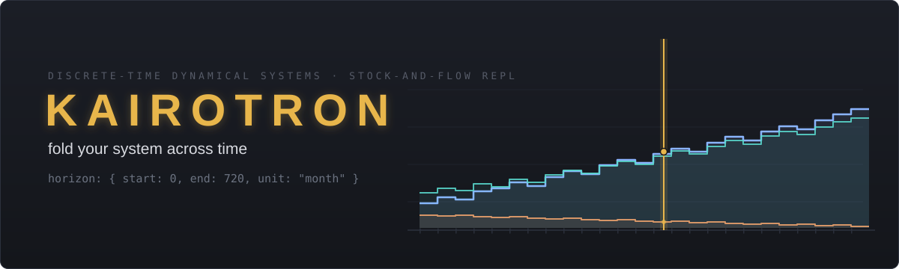

<p align="center">
  
</p>

# Kairotron

A text-first playground for **discrete-time dynamical systems** — the stock-and-flow
tradition of TidalCycles and Strudel, applied to numbers instead of sound.

You write a model in a small DSL, set a finite horizon `(start, end, tickUnit)`, press
**Run**, and the engine *folds the state vector across the ticks* — producing an
append-only timeline of immutable snapshots you can scrub, inspect, export, and
re-run at a different tick. Domain-agnostic by design: finance, hydrology,
epidemiology, batteries, population, dosing schedules, supply chains. Nothing
domain-specific is hardcoded in the engine.

> Tidal turns patterns into sound. Kairotron turns rules into a series — and
> shows you *which line of code* moved each stock at each tick.

## Quick start

```bash
git clone https://github.com/slowsigma/Kairotron && cd Kairotron
npm install

# Text-first: run an example model in the CLI
npx tsx src/cli.ts examples/retirement.ts --flows

# What-if: fork a branch at tick 6 where a raise lifts the contribution
npx tsx src/cli.ts examples/retirement.ts --fork-at 6 \
  --variant examples/retirement-boost.ts --diff

# Monte Carlo: sample 500 stochastic paths and print the percentile table
npx tsx src/cli.ts examples/retirement-mc.ts --mc 500 --seed 1

# Browser REPL: live editor + timeline chart + scrubber + code highlighting
npm run dev        # serves web/ at http://localhost:5173 (docs under /docs)

# Tests (293, incl. numeric verification against hand-rolled loops)
npm test
```

## One model, end to end

Monthly retirement cashflow — a growing pre-tax pot, cash on a lower yield
([full source](examples/retirement.ts)):

```ts
import { derived, flow, model, pct } from "./src/dsl/model.js";

export default model({
  horizon: { start: 0, end: 12, unit: "month" },
  constants: {
    contribution: 2750,
    growth: pct(7, "year"),      // rate carries its unit; the engine
    cashYield:  pct(1.5, "year") // normalizes it to the tick at run time
  },
  stocks: {
    preTax: 120000,
    cash: 25000
  },
  rules: [
    flow("preTax", (c) => c.constants.contribution, "monthly contribution"),
    flow("preTax", (c) => c.stocks.preTax * c.perTick("growth"), "growth @ 7%/year"),
    flow("cash",   (c) => c.stocks.cash * c.perTick("cashYield"), "interest @ 1.5%/year")
  ],
  derived: [
    derived("netWorth", (c) => c.stocks.preTax + c.stocks.cash)
  ]
});
```

Run it and you get a table — a snapshot per tick, derived values marked `~`:

```
  t      preTax       cash   ~netWorth
 --  ----------  ---------  ---------
  0  120,000.00  25,000.00  145,000.00
  1  123,466.04  25,031.25  148,497.29
  2  126,952.30  25,062.54  152,014.84
```

Add `--flows` and every delta comes with **provenance**: which rule wrote it, from
which source line. This is what powers playhead-linked code highlighting in the REPL.

```
t=1
      +2,750.00  preTax  monthly contribution  @/path/to/repo/examples/retirement.ts:17:5
        +716.04  preTax  growth @ 7%/year      @/path/to/repo/examples/retirement.ts:18:5
         +31.25  cash    interest @ 1.5%/year  @/path/to/repo/examples/retirement.ts:19:5
```

Because the tick unit is **semantics**, not just tempo, re-ticking changes the model
rather than re-scoring it — `--unit year` re-expresses the same *duration* on a
yearly grid (0..12 monthly ticks become 0..1 yearly tick), re-normalizing the
7%/year rate so the contribution means something different per tick:

| | monthly tick | yearly tick |
|---|---|---|
| growth per tick | 7%/12 | 7% |
| contribution per tick | 2750 | 2750 (applied once) |
| result after tick 1 | `162,953` after 12 ticks | `131,342` after 1 tick |

Conversions that assume a calendar need a declared **day-count convention**
(`--convention abstract | actual/365 | 30/360`): the abstract year is exactly
52 weeks (364 days), so quarterly schedules land on whole daily ticks there and
on 30/360 (90 days) but not under actual/365 (91.25) — where the engine refuses
rather than fudging. A duration that doesn't divide into whole ticks is rejected
the same way; `--end` always takes raw ticks in the target unit if you want it.

Forks re-tick too: `--fork-at 6` onto a daily variant re-expresses the trunk's
first six monthly ticks at their exact daily moments (months 1, 2, 4, 5 land
between days and drop out of the shared prefix; months 0, 3, 6 land on days 0,
91, 182), `lagged` reads that sparse prefix hold-last, and `--diff` aligns the
trunk by duration:

```
npx tsx src/cli.ts examples/retirement.ts --fork-at 6 \
  --variant examples/retirement-daily.ts --diff
```

## How it works

The whole engine is `reduce` over ticks: `s_t = step(s_{t-1}, t, params)`.

- **Three kinds of values.** *Constants* (fixed, may carry a per-unit rate),
  *variables* (the state vector of named numeric stocks, evolved by the fold,
  never mutated in place), and *derived values* (read-only projections attached
  to every snapshot — acyclic by construction, they can never feed back into
  the step).
- **Immutable snapshots.** History is an append-only array of frozen state
  vectors, each tagged with the deltas and the source locations that produced
  them. Nothing is rewritten — the sequence of fixed values *is* the mutation.
- **Abstract time by default.** Ticks are plain numbers. A calendar is a
  display overlay you add later — `horizon.basis = date("1971-03-15")` anchors
  tick 0 to a civil date, and *nothing else changes*: the fold stays tick-pure.
  Rules then gate on dates (`when(c => c.date().year >= 2044, ...)`, or the
  horizon-bound `c.when()` / plan-shaped `when(t, unit, basis, convention)`),
  snapshots carry the basis, tables and CSV gain a `date` column, and chart axes
  render calendar labels. With a basis,
  month/quarter/year ticks step the *civil* calendar (Jan 31 + 1 monthly tick →
  Feb 28/29 — leap-true under `actual/365`, clamped at 30 under `30/360`).
- **Rates carry units.** `pct(7, "year")` becomes 7/12 per monthly tick,
  7/52 per weekly tick. Change the tick unit, change the meaning. Cross-unit
  conversion is duration-preserving and governed by a declared **day-count
  convention** (`abstract`, `actual/365`, `30/360`) — everything must land on
  whole ticks or the engine says so.
- **Gating, schedules, delays.** Rules compose: `when(guard, rule)`,
  `unless(...)`, `every(7, ...)`, `once(t, ...)`, `between(a, b, ...)`, and
  `lagged(stock, n)` for dependencies on earlier snapshots.
- **Mini-notation sugar.** The same rules in the plan's terse grammar
  ([retirement-mini.ts](examples/retirement-mini.ts)): `mini(\`preTax += preTax * growth "growth"\`)`
  transpiles statements — `+= -= ->`, `when/unless/every/once/between` prefixes,
  `k` magnitudes, `2.5%` percent, duration amounts `3k/mo` (normalized to the
  tick like any rate), `lag(stock, n)`, guards with `&& || !` and date fields
  (`year`, `month`) — into the same Rule objects, with provenance pointing at
  each statement's own line. `miniDerived` covers `~netWorth = preTax + cash`.
- **Branches are free.** `fork(history, t, variantModel)` continues the fold from
  any snapshot with a different rule set — the shared prefix is the *same* frozen
  snapshots, `lagged` reads across the fork point into the trunk, and a variant
  can even run past the trunk's horizon. Retire at 60 vs 65 costs no copies. A
  branch may even continue on a **different tick unit**: the trunk prefix is
  re-expressed at the moments where both grids agree, and `lagged` reads it
  hold-last.
- **Deterministic by default, Monte Carlo on demand.** A plain run folds the
  expected value even when the model declares randomness. Mark a rate as a
  random sequence — `stochastic(pct(7, "year"), normal(pct(15, "year")))` —
  and `--mc <paths>` folds N seeded paths in parallel (browser worker pool,
  CLI sequential) into a percentile timeline. Per-tick noise scales with
  `sqrt(tick/perUnit)`, so the outcome spread doesn't depend on tick
  granularity; same seed replays every path bit for bit. Seeding a fork
  (`--mc` with `--fork-at`) gives *same-world* what-ifs: each branch path
  continues its trunk path's own shock sequence, so the band gap is the
  decision's effect with the noise held fixed. Must keep the trunk's tick grid
  (unit, convention, basis) — a re-ticked branch is a new random world, and the
  engine rejects it rather than mixing shock sequences.

### Monte Carlo is opt-in

A stochastic variant reads like the deterministic one
([retirement-mc.ts](examples/retirement-mc.ts)) — the only change is that a rate
starts carrying noise:

```ts
constants: {
  contribution: 2750,
  growth: stochastic(pct(7, "year"), normal(pct(15, "year"))), // 7%/yr, 15%/yr vol
  cashYield: pct(1.5, "year"),
}
```

A plain run still folds the *expected-value* path — the very table above. Sample
the randomness instead and each tick becomes a distribution:

```
npx tsx src/cli.ts examples/retirement-mc.ts --mc 2000 --seed 3 --percentiles 5,50,95
```

```
monte carlo — 2000 paths × 240 ticks · seed 3
  t   preTax·p5    preTax·p50    preTax·p95    cash·p5   cash·p50   cash·p95  ~netWorth·p5  ~netWorth·p50  ~netWorth·p95
---  ----------  ------------  ------------  ---------  ---------  ---------  ------------  -------------  -------------
  0  120,000.00    120,000.00    120,000.00  25,000.00  25,000.00  25,000.00    145,000.00     145,000.00     145,000.00
  1  114,557.95    123,532.72    132,103.19  25,031.25  25,031.25  25,031.25    139,589.20     148,563.97     157,134.44
240  770,714.15  1,685,034.99  3,878,220.04  33,740.15  33,740.15  33,740.15    804,454.30   1,718,775.14   3,911,960.19
```

The cash columns collapse everywhere (nothing random touches them), and the path
mean converges to the expected-value fold — the noise is mean-preserving, it
only redistributes. In the browser the same mode draws **percentile bands**
(p10–p90, p25–p75, median) behind the stocks; in a worker pool, same seed
replaying bit-for-bit.

## Examples

Realistic exemplars, each verified tick-by-tick against a hand-rolled loop in
[`test/examples.test.ts`](test/examples.test.ts):

| Model | Domain | What it exercises |
|---|---|---|
| [`retirement.ts`](examples/retirement.ts) | personal finance | rates with per-units, derived projections |
| [`retirement-mini.ts`](examples/retirement-mini.ts) | personal finance | the same fold in the mini-notation sugar (`mini`/`miniDerived`) |
| [`retirement-boost.ts`](examples/retirement-boost.ts) | personal finance | what-if fork of the model above (raise at tick 6) |
| [`retirement-daily.ts`](examples/retirement-daily.ts) | personal finance | re-ticked fork: the same year on a daily grid |
| [`reservoir.ts`](examples/reservoir.ts) | hydrology | monthly rates on daily ticks, proportional evaporation |
| [`epidemic-sir.ts`](examples/epidemic-sir.ts) | epidemiology | stock↔stock transfers, guarded recurring schedules |
| [`supply-chain.ts`](examples/supply-chain.ts) | operations | delays, conservation of units, bullwhip oscillation |
| [`rmd-calendar.ts`](examples/rmd-calendar.ts) | personal finance | calendar basis: date-gated contributions and RMDs (`age >= 73`) |
| [`retirement-mc.ts`](examples/retirement-mc.ts) | personal finance | Monte Carlo: a stochastic growth rate folded over seeded paths |
| [`retirement-mc-cautious.ts`](examples/retirement-mc-cautious.ts) | personal finance | same-world fork: de-risking replayed against each trunk path's shocks |

## Browser REPL

`npm run dev` starts a REPL with a model editor and a stacked timeline of the
stocks. Scrub the playhead (or use the arrow keys) and the editor highlights
*the rule that moved each stock at that tick* — Strudel's
[`withLoc` trick](https://strudel.cc/learn/visual-feedback/), aimed at data.
Tab through the inspector for the full state vector at any tick, and export
the history as CSV or JSON. The toolbar re-ticks without touching the model:
changing **unit** with start/end on auto re-expresses the horizon at the same
duration (rates re-normalize), and **convention** switches the day-count basis.

**⑂ Fork** branches the timeline at the playhead: the branch gets its own editor
buffer, the trunk's continuation ghosts behind it as dashed lines, and a Δ-pane
plots branch-minus-trunk — the what-if answer, per stock, per tick. Branch chips
switch timelines; re-running the trunk re-forks them automatically.

With **mc paths** set in the toolbar, a stochastic model folds N seeded paths on
a **worker pool** (the engine is pure, so the paths are embarrassingly parallel)
and the charts swap to percentile bands; the inspector and CSV/JSON export then
report the tick's distribution instead of a point. Fork a branch with paths on
and each branch path continues its trunk path's shocks — a same-world what-if.
Leave the field empty and everything is the deterministic expected-value run.

**Share** puts the session in the URL: the trunk's last-run model code and
horizon, the Monte Carlo controls, the playhead, and each branch's fork tick,
buffer, and own horizon when re-ticked — deflate-compressed into one query
parameter (with an uncompressed fallback), no server involved. Opening the link
folds the trunk, re-forks the branches, and lands the playhead where you left
it. A share link runs the model code it carries — treat one like a pasted
script, and only open links from sources you'd trust with pasted code.

**💾 Save** keeps scenario sets in `localStorage`: named model variants (code +
horizon/MC controls) grouped into sets — *retirement / aggressive, cautious, …*
— the spreadsheet-tabs notion of scenario without leaving the REPL. The
**scenario** dropdown loads one back (buffer, controls, immediate re-run);
**✕** deletes it. Branches stay a share-URL notion: inside a set, what-ifs are
separate scenarios, not forks stacked on a trunk.

Zero runtime dependencies: the engine imports unchanged from `src/`, the UI is
vanilla TypeScript over SVG.

## Project layout

```
src/
  core/     fold runner, units, seeded PRNG, immutable snapshot types (pure, no UI)
  dsl/      model({...}) builder + rule constructors + provenance capture
  outputs/  table / CSV / flows / percentile renderers
web/        browser REPL (Vite, vanilla TS — editor, chart, scrubber, inspector, MC worker pool, share URLs, scenario sets)
examples/   exemplar models across four domains
test/       units, fold, gating, derived, exemplars, Monte Carlo, REPL, UI smoke tests
docs/       VitePress docs site + plan.md (the plan), Concept-Search.md, time-varying-values.md
```

## Roadmap

Milestones from [`docs/plan.md`](docs/plan.md):

- [x] Engine prototype — fold runner, tick units, stock/flow DSL, CLI table
- [x] Mini-notation sugar — `mini()`/`miniDerived()`: the plan's terse statement grammar, provenance intact
- [x] Gating & events — guards, one-shot / recurring schedules, delays
- [x] Derived quantities — read-only projections on every snapshot
- [x] Browser REPL — editor, stacked timeline, scrubber, code highlighting
- [x] Branches & what-if — fork from any snapshot (free, because states never mutate)
- [x] Tick re-normalization — same model, new tick unit; day-count conventions
- [x] Calendar overlay — basis + `date()`, civil date gating/display (`when(...)`, `c.date()`), date column & calendar axes
- [x] Monte Carlo mode — random rate sequences (`stochastic`/`normal`/`uniform`), seeded paths on a worker pool, percentile bands over the timeline
- [x] Shareable model URLs (plan.md's "later") — session (model + horizon + MC + playhead + branches) in a compressed query parameter
- [x] Saved scenario sets (plan.md's "later") — named model variants grouped into sets in localStorage, loadable from the toolbar
- [x] Polished documentation — a VitePress docs set (concepts, tutorial, DSL/CLI/outputs references, guides, cookbook, troubleshooting) whose `ts run` examples are extracted, executed, and typechecked in CI

## Documentation

Public docs live in [`docs/`](docs/) as a [VitePress](https://vitepress.dev/) site
— concepts, getting-started tutorial, DSL / mini-notation / CLI / outputs
references, guides (browser REPL, units & calendar, branches, Monte Carlo),
cookbook, embedding, troubleshooting, glossary, contributor guide:

```bash
npm run docs:dev      # serve the docs locally
npm run docs:check    # example blocks (run + typecheck) + asset/link check + site build
```

## Design docs

- [`docs/plan.md`](docs/plan.md) — semantics, execution model, naming, milestones
- [`docs/Concept-Search.md`](docs/Concept-Search.md) — the domain math
- [`docs/time-varying-values.md`](docs/time-varying-values.md) — the prior-art landscape

## Scope and disclaimer

Kairotron is a **time-centric programmable calculator** — a scratchpad for
discrete-time dynamical systems, not a modeling engine for markets, taxes,
weather, or reality. It computes exactly what your rules tell it to and
nothing else, so a result is only as good as the model behind it — and even
then, approximations are built in by design (rate conversion, day-count
conventions, floating-point arithmetic, Monte Carlo sampling).

**We make no guarantees as to the accuracy, correctness, completeness, or
fitness for any purpose of any result. Use this at your own risk.** Treat
every number it prints — especially a financial projection — as a thinking
tool, not as advice or a forecast, and never as a substitute for your own
judgment or professional guidance. Before you trust a model, verify it the
way this repo's test suite does: against a hand-rolled loop.

## License

MIT — see [`LICENSE`](LICENSE).
